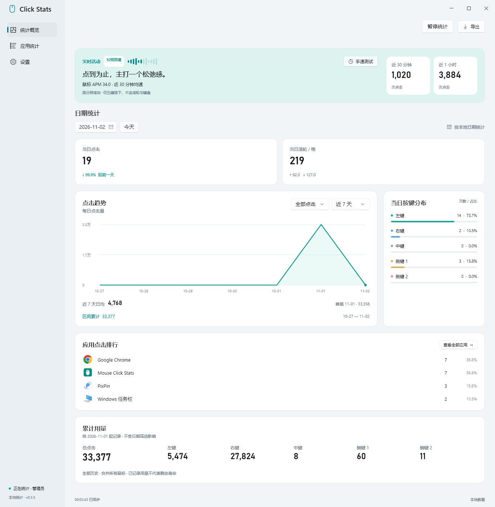

# Mouse Click Stats

一款 Windows 鼠标使用统计工具，记录每天点了多少次、常用哪些应用，以及最近的点击节奏。所有数据只保存在本机。

**Windows 10 1903+ / Windows 11 · x64 · v0.3.5**

## 界面展示



## 功能一览

| 功能 | 内容 |
| --- | --- |
| 日常统计 | 鼠标五键、上下与横向滚轮，按日期查看 |
| 趋势与累计 | 7 / 30 / 90 天趋势、日均、峰值与全历史累计 |
| 应用排行 | 真实应用图标、点击占比与明细，任务栏交互单独归类 |
| 实时活动 | 近 30 分钟 / 1 小时点击数、鼠标 APM、左右键手速测试 |
| 使用体验 | 深浅主题、托盘运行、暂停 / 恢复、CSV 导出、可选管理员权限与登录自启 |

## 快速开始

1. 完整解压便携包 `MouseClickStats-0.3.5-portable`，保留 `runtime` 目录。
2. 双击 `MouseClickStats.exe`，启动统计和面板，无需另装运行库。
3. 关闭面板后继续在托盘统计；需要停止时，从托盘选择“退出”。

> 若管理员权限运行的应用出现漏记，可在设置中提升采集权限。希望下次登录仍以管理员权限启动，需要另行选择对应的登录自启模式并应用。详见[使用指南](docs/usage.md)。

## 数据与隐私

统计保存在 `%LOCALAPPDATA%\MouseClickStats\stats.db`。程序不联网、不上传，不保存逐次事件、鼠标轨迹、窗口标题或键盘内容。

所有鼠标合并统计。备份前请正常退出后台；清空数据会删除全部历史，无法撤销。

## 从源码构建

需要 Windows x64、Python 3.10+，在仓库根目录执行：

```powershell
.\scripts\build.ps1
```

脚本自动准备项目内工具链、构建并运行核心测试，输出到 `dist/MouseClickStats-0.3.5-portable`。依赖、打包及界面验证见[开发与构建](docs/development.md)。

## 文档

- [使用指南](docs/usage.md)：权限与自启、统计口径、备份及诊断。
- [开发与构建](docs/development.md)：环境、构建命令、发布布局和验证记录。
- [更新记录](docs/changelog.md)：各版本的功能与修复。
- [已知问题](docs/known-issues.md)：运行库兼容与问题排查。
